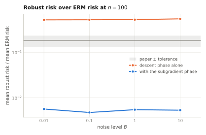

# Variance-based regularization with convex objectives

> Status. `partially reproduced`

## Reference

John Duchi and Hongseok Namkoong. Variance-based regularization with
convex objectives. Journal of Machine Learning Research, 20(68):1-55,
2019. arXiv:1610.02581. An earlier version appeared at NeurIPS 2017.

Citation checked against the JMLR page on 2026-11-15. The authors' public
code (`hsnamkoong/robustopt`) holds projection routines only, not the
simulation reproduced here.

## Claim

We reproduce the simulation of Section 5.2. The paper minimizes the
robustly regularized risk

$$
R_n(\theta, \mathcal P_n) = \sup_{P} \left\{ \mathbb E_P[\ell(\theta; X)] :
D_\phi(P \,\|\, \hat P_n) \le \rho / n \right\}, \qquad \phi(t) = \tfrac12 (t - 1)^2,
$$

and compares its minimizer $\hat\theta^{\rm rob}$ with the empirical risk
minimizer $\hat\theta^{\rm erm}$ through the population risk
$R(\theta) = \tfrac12 \|\theta - v\|_2^2$.

| Claim id | Statement |
| --- | --- |
| c1 | The robust solution has lower population risk than ERM in every replication, for every sample size and noise level |
| c2 | For $B = 1$ and $n = 1000$ the robust solution recovers $v$, so its risk is zero up to the numerical precision of the solver |
| c3 | For $B = 1$ and $n = 100$, the one setting where the robust solution is not $v$, its risk is about 0.18 times the ERM risk |

The location, metric, paper value and tolerance of each claim are fixed
in `claims.py`, committed before the full run.

## Setup

| Item | Value |
| --- | --- |
| Loss | $\ell(\theta; x) = \tfrac12 \lVert\theta - v\rVert_2^2 + x^\top(\theta - v)$ with $d = 50$ |
| Data | $X \sim \mathrm{Uni}(\{-B, B\}^d)$, $B \in \{0.01, 0.1, 1, 10\}$, $n \in \{10^2, 5\cdot10^2, 10^3, 5\cdot10^3, 10^4\}$ |
| Domain | $\Theta = \{\theta : \lVert\theta\rVert_2 \le r\}$, $r = 10$, $v = \tfrac{r}{2\sqrt d}\mathbf 1$ |
| Radius | $\rho = \log(2/\delta) + d \log(2nDL)$ (Eq. 17), $\delta = 0.05$, $D = 2r$, $L = 3r + \sqrt d B$ |
| Optora components | `optora.ChiSquareAmbiguitySet` with radius $2\rho/n$, since Optora's chi-square divergence $\sum_i (q_i - p_i)^2 / p_i$ equals $2 D_\phi$ |
| Robust solver | Two phases, batched over replications. First the solver of Section 5.1, projected gradient descent with a backtracking (Armijo) line search. Then a projected subgradient method with step $2/(k+1)$ and $k$-weighted averaging (Lacoste-Julien, Schmidt and Bach 2012), valid because $R_n$ is 1-strongly convex. Each replication keeps the point with the lower robust objective. Both phases take values and gradients from Optora only |
| ERM solver | Closed form $\hat\theta^{\rm erm} = \Pi_\Theta(v - \bar X_n)$, the exact minimizer of the empirical risk over $\Theta$ |
| Replications | 1,200 per $(n, B)$ as in the paper, split into 3 seeds of 400 so each claim has a spread over seeds |
| Precision | float64 |
| Hardware | RTX 3050 Laptop 6 GB (full run), CPU (smoke run) |

Known discrepancy, recorded before any run. Every ERM entry of Table 1
with $B \ge 0.1$ equals $dB^2/(12n)$ to about 1%. The setup as stated gives
$\mathbb E[R(\hat\theta^{\rm erm})] = \tfrac12 \mathbb E\lVert\bar X_n\rVert_2^2 = dB^2/(2n)$,
six times larger. We run the setup as stated. Claims c1 and c3 do not
depend on this scale and c2 sits at the numerical floor.

Solver change, made during the independent solver check (workflow step 6)
and before the full run. At $n = 100$ the radius $2\rho/n \approx 12$ lets
the chi-square ball hold every distribution on a set of about 8 tied top
losses, so the maximizer is not unique there and $R_n$ is not
differentiable. Section 5.1 states that $R_n$ is differentiable whenever
the losses have nonzero variance, but that does not hold in this regime.
The Section 5.1 solver stalls at such points: on 100 replications at
$n = 100$, $B = 1$ it gives a robust to ERM risk ratio of 0.519, while the
exact minimizer from an independent conic solver (CVXPY with Clarabel)
gives 0.006. The paper reports 0.182. Optora's worst-case value at the
conic optimum equals the conic objective to $10^{-6}$, and its gradient
matches finite differences, so the stall is a property of the solver, not
of Optora. With the user's approval the main result uses the two-phase
solver above, which matches the conic minimizer to within 1% in mean
risk. The descent phase alone is still recorded for every cell, so the
stall is reported next to it.

The subgradient phase runs only for replications whose descent point is
farther than $10^{-10}$ from $v$, and the table in the findings reports
that share per cell. A descent point at $v$ is kept as it is. This saves
hours of GPU time and is checked independently. In the solver check, the
descent phase ended at $v$ in all 400 replications at $n = 1000$,
$n = 5000$ and $n = 10^4$ (and in none at $n = 100$), and the conic solver
puts the minimizer at $v$ for every replication it solved at $n = 500$
(20 replications), $n = 5000$ and $n = 10^4$ (3 replications each, risk
below $10^{-18}$).

## Run

```bash
python -m papers.duchi2019_variance_regularization.run --config papers/duchi2019_variance_regularization/configs/smoke.toml
python -m papers.duchi2019_variance_regularization.run --config papers/duchi2019_variance_regularization/configs/full.toml
```

## Result

See the results table in the root `README.md`, generated from
`results/duchi2019_variance_regularization.<claim_id>.json`.

The figures under Findings are drawn by `python -m tools.figures` from
those records and from the curve record
`results/curves/duchi2019_variance_regularization.json`.

## Findings

Full run on 2026-11-15 with Optora 0.2.0, float64, on the RTX 3050. It took
3.8 hours of GPU time. The complete table is in
`runs/duchi2019_variance_regularization/full_table.md`, and every risk below
is a mean over the 1,200 replications of a cell.

| Claim | Paper | This run (mean over seeds, sample std) | Within tolerance |
| --- | --- | --- | --- |
| c1 | 1.0 | 1.0 (std 0) | yes |
| c2 | 6.32e-18 | 0 (std 0) | yes |
| c3 | 0.182 | 0.0055 (std 0.0013) | no |

Claims c1 and c2 reproduce. The robust solution beats ERM in every one of
the 24,000 replications, and for every $n \ge 500$ the descent phase stops at
$v$ itself, so no replication there needed the subgradient phase and the
mean risk is at most $2\cdot10^{-30}$. The paper's $6.32\cdot10^{-18}$ at
$n = 1000$ is consistent with the same point reached to a looser solver
tolerance.

Claim c3 does not reproduce, and the gap goes in the direction the solver
check predicted. At $n = 100$ the ratio of mean robust risk to mean ERM risk
is

| $B$ | Paper | Exact minimizer (two phases) | Descent phase only |
| --- | --- | --- | --- |
| 0.01 | 0.172-0.183 | 0.0057 | 0.516 |
| 0.1 | 0.172-0.183 | 0.0048 | 0.519 |
| 1 | 0.182 | 0.0055 | 0.522 |
| 10 | 0.172-0.183 | 0.0053 | 0.544 |

<picture>
  <source media="(prefers-color-scheme: dark)" srcset="figures/risk_ratio-dark.svg">
  
</picture>

The figure shows the same ratios on a logarithmic axis, with the band
of values that count as reproduced around the 0.182 of the paper.

The ratio barely moves over three orders of magnitude in $B$, in either
solver column. The ERM scale gap below acts like a smaller $B$, so it is
unlikely to explain the difference. The
paper's value lies between the exact minimizer of $R_n$ and the point where
the Section 5.1 solver stalls. This fits an inexact solve of a nonsmooth
problem, but without the authors' simulation code we cannot pin down which
solver or stopping rule gives 0.18. The qualitative conclusion of Section
5.2 is stronger at the exact minimizer, with about 180 times less risk than
ERM at $n = 100$ instead of about 5 times.

The ERM column confirms the discrepancy recorded before the run. At
$B = 1$, $n = 100$ the mean ERM risk is 0.251, against $dB^2/(2n) = 0.25$ for
the stated setup and 0.042 in Table 1, and the same factor of six holds in
every cell with $B \ge 0.1$.

Optora. The chi-square worst case matched the conic reference and finite
differences throughout, and no run failed. The cost was the solve itself.
The $n = 100$ cells took about 600 seconds for 1,200 replications, most of
it in 5,000 subgradient steps on a $400 \times 100$ batch, where the
float64 tilt bisection of Optora 0.2.0 is bound by kernel launches. This
became Optora issue #108, fixed upstream by an exact sort-based chi-square
solve after this run. A rerun on a release that includes the fix is the
natural check of that change.
