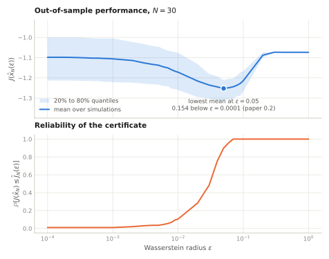

# Data-driven distributionally robust optimization using the Wasserstein metric

> Status. `reproduced`

## Reference

Peyman Mohajerin Esfahani and Daniel Kuhn. Data-driven distributionally
robust optimization using the Wasserstein metric: performance guarantees
and tractable reformulations. Mathematical Programming, 171(1-2):115-166,
2018. doi:10.1007/s10107-017-1172-1. arXiv:1505.05116.

Citation checked against the published version on 2026-11-15. Section
numbers below follow arXiv v3. No public code accompanies the paper.

## Claim

We reproduce the mean-risk portfolio experiment of Section 7.2.A. For a
training dataset $\hat\Xi_N$ of $N$ return vectors, the paper solves

$$
\hat J_N(\varepsilon) = \inf_{x \in \mathbb X,\, \tau \in \mathbb R}\;
\sup_{Q \in \mathbb B_\varepsilon(\hat P_N)}
\mathbb E_Q\left[\max_{k \le 2} a_k \langle x, \xi\rangle + b_k \tau\right],
$$

where $\mathbb B_\varepsilon(\hat P_N)$ is the 1-Wasserstein ball of
radius $\varepsilon$ around the empirical distribution and $\mathbb X$ is
the probability simplex (Eq. 50). The minimizer $\hat x_N(\varepsilon)$ has
out-of-sample performance $J(\hat x_N(\varepsilon))$, the mean-CVaR
objective under the true distribution, and $\hat J_N(\varepsilon)$
certifies it when $J(\hat x_N(\varepsilon)) \le \hat J_N(\varepsilon)$.

| Claim id | Statement |
| --- | --- |
| c1 | For a large radius the robust portfolio is the equally weighted one (Proposition 7.2, Figure 4) |
| c2 | At $\varepsilon = 1$ and $N = 300$ the certificate holds in every simulation, so the reliability is one (Figure 5(b)) |
| c3 | With $N = 30$ samples a well chosen radius improves the out-of-sample performance over the nearly nonrobust radius $10^{-4}$ by about 0.2 (Figure 5(a)) |

The location, metric, paper value and tolerance of each claim are fixed
in `claims.py`, committed before the full run. The values of c2 and c3 are
read from the figures. The tolerance of c3 is loose for that reason.

## Setup

| Item | Value |
| --- | --- |
| Returns | $m = 10$ assets, $\xi_i = \psi + \zeta_i$ with $\psi \sim N(0, 0.02^2)$ and $\zeta_i \sim N(0.03\,i, (0.025\,i)^2)$ independent (Section 7.2) |
| Loss | $a = (-1, -1 - \rho/\alpha)$, $b = (\rho, \rho(1 - 1/\alpha))$, $\alpha = 0.2$, $\rho = 10$ (Section 7.1) |
| Ambiguity set | 1-Wasserstein ball with the 1-norm on $\mathbb R^m$, support $\Xi = \mathbb R^m$ (Section 7.2) |
| Out-of-sample $J$ | Closed form under the true normal distribution, $J(x) = -(1 + \rho)\mu^\top x + \frac{\rho}{\alpha}\varphi(\Phi^{-1}(\alpha))\sqrt{x^\top \Sigma x}$, as Section 7.2.A computes it analytically |
| Simulations | 200 independent training datasets per sample size, one seed each (seeds 0-199) |
| c1, c2 | $N = 300$, $\varepsilon = 1$ |
| c3 | $N = 30$, $\varepsilon \in \{b \cdot 10^c : b \in \{1, \dots, 9\}, c \in \{-4, \dots, -1\}\} \cup \{1\}$, 37 radii |
| Optora components | `optora.WassersteinAmbiguitySet` with one batched ground cost of shape `(200, 1, n, n)` and the radii as a batch (Optora 0.3.0, #112) |
| Finite support | The $N$ samples and the $2m$ points $\pm D e_j$, $D = 10^6$, with nominal mass $1/N$ on the samples and 0 on the far points, cost $\lVert\xi - \xi'\rVert_1$. By Corollary 5.1 the worst case over $\mathbb R^m$ is $\frac1N\sum_i \ell(\hat\xi_i) + \varepsilon \max_k \lvert a_k\rvert \lVert x\rVert_\infty$, a supremum that is approached but not attained as mass $\varepsilon/D$ moves to distance $D$. This support gives the same value up to $O(1/D)$, which was checked against the closed form and the linear program to about $10^{-8}$ |
| Robust solver | Central-cut ellipsoid method (Bland, Goldfarb and Todd 1981) on $(y, \tau) \in \mathbb R^{10}$ with $x = e_{10} + U y$, where $U$ is an orthonormal basis of $\{\mathbf 1^\top x = 0\}$, batched over simulations and radii. Values and subgradients come from Optora only, and a centre with some $x_j < 0$ gets the cut $-\nabla x_j$. The first ellipsoid is centred at the portfolio fully invested in asset 10 with $\tau = 0$, away from the answer of c1, and contains the simplex times $[-\tau_{\max}, \tau_{\max}]$ with $\tau_{\max} = \max_{i,j} \lvert\hat\xi_{ij}\rvert$, which holds an optimal $\tau$ because the radius term of Corollary 5.1 does not depend on $\tau$. The output is the feasible centre of lowest value after 3000 steps |
| Certificate | $\hat J_N(\varepsilon)$ is Optora's worst-case value at the returned $(\hat x, \hat\tau)$. For this pair $J(\hat x) \le \mathbb E_P[\ell(\hat x, \hat\tau, \xi)]$, which is at most the worst case over the ball whenever $P$ lies in it, the event behind Theorem 3.4. The finite support changes that worst case by $O(1/D)$ only, so c2 tests the same event |
| Reference solver | The linear program of Theorem 4.2 with $\Xi = \mathbb R^m$, solved by HiGHS through `scipy.optimize.linprog` for every simulation and radius. It is reported next to the results and is never the source of a claim value |
| Precision | float64 |
| Hardware | RTX 3050 Laptop 6 GB (full run), CPU (smoke run) |

Choices recorded before any full run.

- The paper writes the moments as $N(0, 2\%)$ and $N(i \times 3\%, i \times 2.5\%)$ without saying whether the second argument is a variance or a standard deviation. Reading it as a standard deviation puts $J$ of the equally weighted portfolio at about $-1.07$, on the scale of Figure 5. Reading it as a variance gives about $+0.76$, which does not fit the figure, so we use standard deviations.
- Section 7.2.B selects radii from $\{b \cdot 10^c : b \in \{0, \dots, 9\}, c \in \{-3, -2, -1\}\}$, but the grid of Figure 5 is not stated. Our sweep covers the horizontal range of Figure 5, from $10^{-4}$ to 1.
- The panels for $N = 3000$ are not reproduced. One batched cost would hold $200 \cdot 3020^2$ float64 entries (about 14.6 GB), and no claim needs them.
- The paper solves the convex reformulation. Here an oracle method on Optora's values is used instead, so that Optora is what produces every claim value. The tolerance of c1 is $10^{-3}$ rather than solver precision for that reason.

Solver change, made during the independent solver check (workflow step 6) and before the full run. The approved plan named a projected subgradient method with step $0.05/\sqrt k$ and averaged iterates. On 8 simulations it left $J(\hat x)$ up to 0.2 away from $J$ of the HiGHS solution at $\varepsilon = 10^{-4}$, $N = 30$, after 5000 steps, which is the size of the effect c3 measures. The outer problem has only 10 variables, so the ellipsoid method fits better. Its volume shrinks by at least $e^{-1/22}$ per step, and on the same 8 simulations after 2000 steps it put $J(\hat x)$ within $3 \cdot 10^{-4}$ of the HiGHS solution's $J$ and $\hat J_N$ within $2 \cdot 10^{-5}$ of the optimal value at every tested radius. Both methods use the same oracle, Optora's value and subgradient.

## Run

```bash
python -m papers.mohajerin2018_wasserstein_dro.run --config papers/mohajerin2018_wasserstein_dro/configs/smoke.toml
python -m papers.mohajerin2018_wasserstein_dro.run --config papers/mohajerin2018_wasserstein_dro/configs/full.toml
```

## Result

See the results table in the root `README.md`, generated from
`results/mohajerin2018_wasserstein_dro.<claim_id>.json`.

The figures under Findings are drawn by `python -m tools.figures` from
those records and from the curve record
`results/curves/mohajerin2018_wasserstein_dro.json`.

## Findings

Full run on 2026-11-15 with Optora 0.3.0, float64, on the RTX 3050. It took
2 hours 12 minutes, about half for each sample size. The complete table is
in `runs/mohajerin2018_wasserstein_dro/full_table.md`.

| Claim | Paper | This run (mean over 200 simulations, sample std) | Within tolerance |
| --- | --- | --- | --- |
| c1 | 0 | 1.6e-9 (std 3.6e-9) | yes |
| c2 | 1.0 | 1.0 (std 0) | yes |
| c3 | 0.2 | 0.154 (std 0.118) | yes |

All three claims reproduce. At $\varepsilon = 1$ and $N = 300$ the robust
portfolio is the equally weighted one in every simulation, with the largest
weight error $3.7\cdot10^{-8}$. HiGHS returns exactly $1/m$ there, and the
largest distance between our portfolio and the HiGHS one is
$3.8\cdot10^{-8}$. The certificate holds in all 200 simulations, but this
is an easy test at this radius. By Corollary 5.1 the radius term alone adds
$\varepsilon \max_k \lvert a_k\rvert \lVert x\rVert_\infty = 5.1$ to the
empirical mean, while $J$ of the equally weighted portfolio is $-1.07$.

The sweep at $N = 30$ shows the shape of Figure 5(a).

| $\varepsilon$ | Mean $J$ | 20% quantile | 80% quantile | Reliability |
| --- | --- | --- | --- | --- |
| $10^{-4}$ | -1.098 | -1.213 | -1.000 | 0.010 |
| $10^{-3}$ | -1.106 | -1.222 | -1.005 | 0.010 |
| $10^{-2}$ | -1.172 | -1.260 | -1.076 | 0.105 |
| 0.03 | -1.236 | -1.302 | -1.181 | 0.485 |
| 0.05 | -1.252 | -1.312 | -1.211 | 0.900 |
| 0.07 | -1.244 | -1.302 | -1.202 | 1.000 |
| 0.1 | -1.214 | -1.268 | -1.167 | 1.000 |
| 0.3 | -1.073 | -1.074 | -1.074 | 1.000 |
| 1 | -1.074 | -1.074 | -1.074 | 1.000 |

<picture>
  <source media="(prefers-color-scheme: dark)" srcset="figures/radius_sweep-dark.svg">
  
</picture>

Figure 5(a) of the paper draws both curves on one plot with two
vertical axes. The figure above gives each its own panel over the
same radii.

The mean $J$ falls until $\varepsilon = 0.05$ and rises after it. From
$\varepsilon = 0.3$ on, every simulation returns the equally weighted
portfolio, so the 20% and 80% quantiles coincide at $-1.074$. The
difference c3 measures is 0.154 on average and positive in 191 of the 200
simulations. Both mean levels lie a little below the values read from the
figure (about $-1.0$ at $10^{-4}$ and $-1.2$ at the minimum), which fits a
reading off a plot, and the difference between them stays inside the
tolerance. The reliability reaches one at $\varepsilon = 0.07$, slightly
above the radius of best mean performance.

Every certificate is within $1.6\cdot10^{-6}$ of the HiGHS optimal value,
at every radius and both sample sizes. So the ellipsoid method on Optora's
values solves the robust problem to well below the effects the claims
measure.

Optora. No mismatch or failure. The batched ground cost of #112 let one
`WassersteinAmbiguitySet` call cover 200 simulations and 37 radii, with a
peak of 0.81 GB on the GPU. The limit was the dense $n \times n$ cost,
which rules out the $N = 3000$ panels (about 14.6 GB). A dense cost matrix
is the standard input of discrete optimal transport, so this is recorded
here rather than filed.
