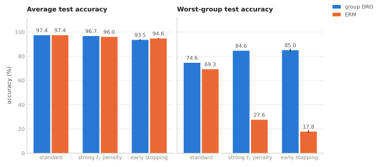
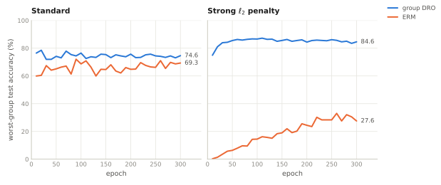

# Distributionally robust neural networks

> Status. `reproduced`

## Reference

Shiori Sagawa, Pang Wei Koh, Tatsunori B. Hashimoto and Percy Liang.
Distributionally robust neural networks. International Conference on
Learning Representations (ICLR 2020). OpenReview `ryxGuJrFvS`,
arXiv:1911.08731, where the title continues "for group shifts: on the
importance of regularization for worst-case generalization".

Citation checked against the OpenReview record in plan step 2b. Section,
table and appendix numbers below follow arXiv v2. The authors' code is at
https://github.com/kohpangwei/group_DRO (commit cbbc1c5).

## Claim

The training distribution is a mixture of $m$ groups $P_g$, and group DRO
minimizes the worst empirical group risk

$$
\hat\theta_{\mathrm{DRO}} = \arg\min_{\theta} \max_{g} \;
    \mathbb{E}_{(x, y) \sim \hat P_g}\big[\ell(\theta; (x, y))\big]
$$

(Eq. 4). On Waterbirds a ResNet-50 classifies landbirds and waterbirds
whose background is land or water, with the background matching the label
for 95% of the training images, so the four groups are the pairs (label,
background). Section 3 compares ERM and group DRO under three regimes. With
the default $\ell_2$ penalty and 300 epochs, both models fit every training
group and still fail on the worst test group. With a strong penalty
$\lambda = 1$ or with early stopping after one epoch, group DRO keeps the
worst group accurate while ERM does not, at a similar average accuracy.

| Claim id | Statement |
| --- | --- |
| c1 | With standard regularization, ERM and group DRO both reach a worst-group training accuracy of 100% (Table 1) |
| c2 | With standard regularization, ERM reaches 97.3% average but 60.0% worst-group test accuracy (Table 1) |
| c3 | With $\lambda = 1$, group DRO raises the worst-group test accuracy from 21.3% for ERM to 84.6% (Table 1) |
| c4 | With early stopping after one epoch, group DRO raises it from 6.7% to 86.0% (Table 1) |
| c5 | In both regularized regimes the average test accuracy of group DRO stays within a few points of ERM (Table 1, Section 3.2) |

The location, metric, paper value and tolerance of each claim are fixed in
`claims.py`, committed before the full run. Table 1 reports one model per
cell, and the worst-group accuracy of a single run varies between seeds,
so c2, c3 and c4 have a tolerance of 15 to 20 points. The tolerance of c5
is the 3 points of the drop that Section 3.2 calls small.

## Setup

| Item | Value |
| --- | --- |
| Data | Waterbirds as released by the authors, read from the Hugging Face dataset `grodino/waterbirds` at revision `e9856c7` (three Parquet files, SHA-256 digests in `data.py`). Its upload script copies every JPEG file of the authors' tarball unchanged with its label, background and split. The training, validation and test sets hold 4,795, 1,199 and 5,794 images, with 56 waterbirds on land in training, as in Section 2.1 |
| Groups | Label times background, the group `2 * y + place` of the authors' `CUBDataset` |
| Model | torchvision ResNet-50 with the `IMAGENET1K_V1` weights (`resnet50-0676ba61.pth`, whose hash torchvision checks on download) and a new linear head with two outputs |
| Input | Resize to 256 by 256, center crop 224, ImageNet normalization, no augmentation (Appendix C.2) |
| Optimizer | SGD with momentum 0.9, batch size 128 and a constant learning rate, the weight decay applied to every parameter |
| Regimes | Standard, learning rate $10^{-3}$, $\lambda = 10^{-4}$, 300 epochs. Strong $\ell_2$ penalty, $10^{-5}$, $\lambda = 1$, 300 epochs. Early stopping, $10^{-3}$, $\lambda = 10^{-4}$, 1 epoch (Appendix C.2) |
| ERM | A random permutation of the training set per epoch |
| Group DRO | `optora.dro.group_losses` and `optora.OnlineGroupDRO` with uniform initial weights and step size 0.01, the authors' `robust_step_size`. An epoch draws 4,795 examples with replacement and every group equally likely, as their `--reweight_groups` sampler does (Algorithm 1) |
| Evaluation | Group accuracies on all three splits in evaluation mode, every 10 epochs and after the last one. The average accuracy weights the group accuracies by the training proportions (Appendix C.1) |
| Seeds | Seed 0 for each 300-epoch run, as Table 1 reports one model per cell. Seeds 0 to 4 for the early-stopping runs |
| Precision | bfloat16 autocast in channels-last format, with the losses and the group weights in float32 |
| Hardware | RTX 3050 Laptop 6 GB |

Choices recorded before any full run.

- Only Waterbirds is reproduced. CelebA has 162,770 training images and
  MultiNLI needs BERT, which take days on this GPU. Table 2 (group
  adjustments) and Table 3 (the grid search with importance weighting) are
  not reproduced, and no claim needs them.
- The authors' tarball on the Stanford server did not answer, and the
  WILDS copy on CodaLab returned no content, so the data comes from the
  Hugging Face copy described above. Its group counts equal the paper's in
  all three splits.
- A batch of 128 does not fit in 6 GB, so every step accumulates the
  gradients of two micro-batches of 64. Batch normalization therefore uses
  the statistics of 64 images. For group DRO the ascent step needs the
  group losses of the whole batch first, so each step evaluates the batch
  once without gradients and without updating the running statistics,
  takes the ascent step, and then backpropagates the weighted loss of each
  micro-batch. Our tests check that this gives the parameters and group
  weights of the authors' `LossComputer` on a full batch.
- The authors trained in float32. bfloat16 autocast runs about 2.2 times
  faster here, 177 against 81 images per second. A training epoch then
  takes about 25 s for ERM and 35 s for group DRO, whose extra pass costs
  the difference, and the whole run about 11 hours.
- The training accuracy of c1 is measured on the final model in evaluation
  mode, while the authors' logs average it over the last epoch in
  training mode.

## Run

```bash
python -m papers.sagawa2020_group_dro.run --config papers/sagawa2020_group_dro/configs/smoke.toml
python -m papers.sagawa2020_group_dro.run --config papers/sagawa2020_group_dro/configs/full.toml
```

The full run saves every finished training run under
`runs/sagawa2020_group_dro/full/`. If it stops, the same command with
`--resume` continues at the first missing run.

## Result

See the results table in the root `README.md`, generated from
`results/sagawa2020_group_dro.<claim_id>.json`.

The figures under Findings are drawn by `python -m tools.figures` from
those records and from the curve record
`results/curves/sagawa2020_group_dro.json`.

## Findings

Full run from 2026-11-19 to 2026-11-20 with Optora 0.4.0, bfloat16 autocast,
on the RTX 3050. The 14 training runs took 12 hours. The complete table is
in `runs/sagawa2020_group_dro/full_table.md` and the group accuracies of
every evaluation are in `full_curves.json` next to it.

| Claim | Paper | This run | Within tolerance |
| --- | --- | --- | --- |
| c1 | 1.0 | 1.000 (seed 0) | yes |
| c2 | 0.373 | 0.281 (seed 0) | yes |
| c3 | 0.633 | 0.570 (seed 0) | yes |
| c4 | 0.793 | 0.672 (mean over 5 seeds, sample std 0.013) | yes |
| c5 | -0.0015 | 0.0057 (seed 0) | yes |

All five claims reproduce. The table below compares every Waterbirds cell
of Table 1 with ours, in percent, as paper / ours. The early-stopping cells
are means over the five seeds.

| Regime | Split | Average, ERM | Average, group DRO | Worst group, ERM | Worst group, group DRO |
| --- | --- | --- | --- | --- | --- |
| Standard | Train | 100.0 / 100.0 | 100.0 / 100.0 | 100.0 / 100.0 | 100.0 / 100.0 |
| Standard | Test | 97.3 / 97.4 | 97.4 / 97.4 | 60.0 / 69.3 | 76.9 / 74.6 |
| Strong $\ell_2$ | Train | 97.6 / 97.7 | 99.1 / 99.0 | 35.7 / 37.5 | 97.5 / 98.0 |
| Strong $\ell_2$ | Test | 95.7 / 96.0 | 96.6 / 96.7 | 21.3 / 27.6 | 84.6 / 84.6 |
| Early stopping | Train | 86.2 / 94.8 | 80.1 / 94.6 | 7.1 / 17.9 | 74.2 / 88.8 |
| Early stopping | Test | 93.8 / 94.6 | 93.2 / 93.5 | 6.7 / 17.8 | 86.0 / 85.0 |

<picture>
  <source media="(prefers-color-scheme: dark)" srcset="figures/test_accuracy-dark.svg">
  
</picture>

The figure shows our test cells of the table. The early-stopping bars
carry one sample standard deviation over the five seeds.

With the strong $\ell_2$ penalty every cell lies within 2 points of the
paper except the worst-group test accuracy of ERM, 27.6% against 21.3%.
That run had not converged. Its worst-group training accuracy grows from
0% at epoch 10 to between 37.5% and 44.6% after epoch 260, and its
worst-group test accuracy follows, from 0.3% to 27.6% with a maximum of
33.0%. Group DRO keeps the worst-group test accuracy between 83.5% and
87.2% from epoch 30 on. So the runs show the trade-off of Section 3.2
directly. ERM gives up the waterbirds on land, the smallest training group
with 56 images, at training and at test time, and group DRO does not.

<picture>
  <source media="(prefers-color-scheme: dark)" srcset="figures/worst_group_by_epoch-dark.svg">
  
</picture>

The figure follows the worst-group test accuracy over the 300 epochs
of the four long runs.

In the standard regime both methods reach 100% worst-group training
accuracy by epoch 20, and the average test accuracy stays between 97.0%
and 97.5% for the whole run. The worst-group test accuracy is not stable.
Over the 30 evaluations of a single run it ranges from 60.0% to 72.1% for
ERM and from 72.0% to 78.5% for group DRO, a spread that contains both
values of Table 1. Our final ERM model lands at 69.3%, near the top of its
range, which is why c2 comes out at 0.281 rather than 0.373. In every
evaluation but one the worst test group is the waterbirds on land, which
the models fit perfectly in training. This is the generalization gap on
the worst group that Section 3.1 describes.

With early stopping, group DRO matches the test cells of the paper within
1 point, a worst-group accuracy of 85.0% (sample std 1.1) against 86.0%.
ERM keeps more of the worst group than in the paper, 17.8% (sample std
1.0) against 6.7% at test, and this lowers c4 to 0.672, with all five
seeds between 0.650 and 0.682. We did not isolate the cause. A model
trained for one epoch depends on its 38 steps, so the data order, batch
normalization over micro-batches of 64 and bfloat16 can all move it, and
Table 1 reports a single run. The training cells differ more, 94.8%
against 86.2% for the average accuracy of ERM, because we evaluate the
final model in evaluation mode while the authors' logs average the
accuracy over the epoch in training mode, starting from a random head. We
recorded this choice before the run.

The average test accuracy of group DRO stays close to that of ERM in both
regularized regimes. It is 0.7 points higher with the strong penalty (0.9
in the paper) and 1.1 points lower with early stopping over five seeds
(0.6 in the paper), in line with the small drop of 1 to 3% that Section
3.2 reports. c5 uses seed 0 alone, where the early-stopping drop is 1.8
points.

An epoch of training took 27.5 s for ERM and 38.5 s for group DRO,
without evaluation, about 10% slower than in the pilot. The GPU stayed at
its power limit of about 45 W at 69 degrees Celsius, with no thermal slowdown reported
by `nvidia-smi` during the run. The pass without gradients makes a group
DRO step about 40% more expensive than an ERM step.

Optora. `OnlineGroupDRO` and `optora.dro.group_losses` from 0.4.0 were used
unchanged, and no run failed. The one gap found before the run was that
the documentation did not say how to combine the online update with
gradient accumulation over micro-batches (optora#120). The recipe used
here, with a test of the accumulated gradient, is now in the Group DRO
section of `docs/training.md` (optora#121). Nothing in the run points to a
problem in the library.
